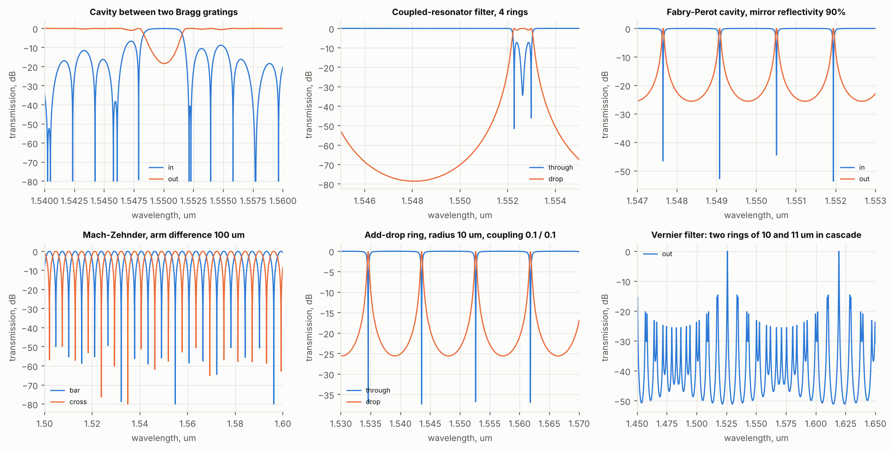

# LightCircuit

A frequency-domain simulator for photonic integrated circuits in C++17, with no dependencies. Components are scattering matrices, circuits are text netlists, and the solver handles any amount of feedback (rings, cavities, loops inside loops) by solving one linear system per wavelength.

The repository is also a library of 69 circuits. Each netlist states, in its first lines, the closed-form result it should reproduce, and carries that result as machine-checked expectations.

## What is inside

| Part | Where | Content |
|---|---|---|
| Components | `cpp/src/{waveguide,phase,coupler,splitter,reflector,bragg}.cpp` | waveguide with dispersion and loss, phase shifter, attenuator, directional coupler, Y-branch, partial reflector, mirror, absorber, Bragg grating by coupled-mode theory |
| Netlist | `cpp/src/netlist.cpp`, `docs/netlist.md` | nine statements, errors reported with their line number |
| Solver | `cpp/src/{circuit,lu,sweep}.cpp` | global scattering system `(I - S P) b = S a`, complex LU with pivoting, wavelength sweep with unitarity and reciprocity defects |
| Analysis | `cpp/src/{analysis,expect}.cpp` | resonance finding with sub-sample refinement, spacing, width, Q, group delay, fifteen kinds of expectation |
| Library | `cases/*.net` | 69 circuits in nine families |
| Results | `reports/cases/*.json`, `reports/figures/cases/*.png` | metrics, checks and spectrum of every circuit |
| Python | `src/lightcircuit` | driver, independent closed forms, report |

312 C++ checks run without a framework; pytest runs every netlist of the library as its own test.

## Results

69 circuits, 386 components, 288 checks, all passing. Full tables in `reports/report.md`.

| Family | Circuits | What is verified |
|---|---|---|
| Waveguides | 5 | loss in dB, group delay ng L / c to 1e-5 |
| Splitter trees | 7 | 1x2 to 1x32: equal power and phase on every output |
| Couplers | 5 | power split, losslessness, isolation |
| Mach-Zehnder | 11 | fringe period lambda^2 / (ng dL) within 0.5%, switch states, extinction limited by coupler or loss imbalance |
| All-pass rings | 10 | free spectral range for four radii, depth of under- and over-coupled resonances, critical coupling, linewidth within 1% |
| Add-drop rings | 10 | drop peak, through minimum, linewidth, a Vernier pair, a ring-loaded interferometer |
| Coupled rings | 6 | filters of order 2 to 6: lossless to 1e-7, unit transmission in the pass band |
| Cavities and mirrors | 10 | Fabry-Perot spacing, contrast and finesse, Sagnac mirror 4k(1-k), Michelson, Bragg peak tanh^2(kL) |
| Phased-array feeds | 5 | delay-line feeds: phase step beta dL between outputs, and its change with wavelength |

For twelve circuits the complete spectrum is also compared point by point with a formula written separately in Python: the largest difference is 3e-10 in linear power over up to 16,001 wavelengths, the size of the rounding in the text output.



## Reading the numbers

- Components are ideal models: couplers and splitters do not depend on wavelength, there is no polarisation, no higher mode, no back-reflection at junctions unless a reflector is placed. The simulator answers "what does this circuit do if every part behaves as specified", not "what will the fabricated chip do".
- The waveguide has first-order dispersion only: constant group index. Over the 100 nm sweeps used here that is the model, not an approximation the checks could detect.
- The comparison formulas use the same component conventions, so they test the solver and the netlist handling, not the component models. The Bragg grating is checked against the same coupled-mode expressions it implements.
- This comparison earned its keep: it caught a real fault, in the reference formula for the Fabry-Perot and not in the solver.
- Linewidths are measured at half contrast between the resonance and the level between resonances, and compared with the exact Airy expression for that definition. The familiar Lorentzian formula is 5% off for the broadest resonances in the library.
- A lossless loop driven exactly on resonance with no way out makes the system singular. The solver reports it instead of returning numbers.
- Ports that are neither linked nor declared external absorb light silently. The number of such ports is printed, and several library circuits were corrected after the losslessness check exposed one.
- The per-circuit result files and figures are generated by `make run`; they are stored so that the library can be browsed without building anything.

## Run it

```
pip install -e ".[dev]"
make build      # cpp/build/lightcircuit and cpp/build/lightcircuit_tests
make test       # C++ checks, then pytest (every netlist is a test)
make run        # solves the library, writes reports/
```

One circuit:

```
cpp/build/lightcircuit check cases/ring_adddrop_symmetric.net
python scripts/simulate.py cases/crow_4_rings.net
python scripts/plot_case.py cases/vernier_cascade.net vernier.png
```

A netlist:

```
# Free spectral range lambda^2 / (ng L) = 9.104 nm
title All-pass ring, radius 10 um
medium lambda0=1.55 neff=2.4 ng=4.2 loss_db_cm=3
sweep 1.50 1.60 16001

comp c coupler kappa=0.05
comp w waveguide length=62.8318530718
link c.4 w.1
link w.2 c.2
port in c.1
port through c.3

expect passive
expect fsr through dips 9.10404 0.005
```

## Layout

```
cpp/include/lightcircuit/   headers, one per subject
cpp/src/                    implementations and the command line program
cpp/tests/                  312 checks with a small harness
cases/                      69 netlists, each with its description and expectations
src/lightcircuit/           Python driver, closed forms, report and figures
docs/                       netlist reference, component reference, methods
reports/                    report, validation table, per-circuit results and spectra
```

## Author

Amir Masominia. PhD in physics (Université Paris-Saclay); postdoctoral researcher working on machine-learning surrogate models, numerical simulation and automated measurement pipelines.

MIT licence.
